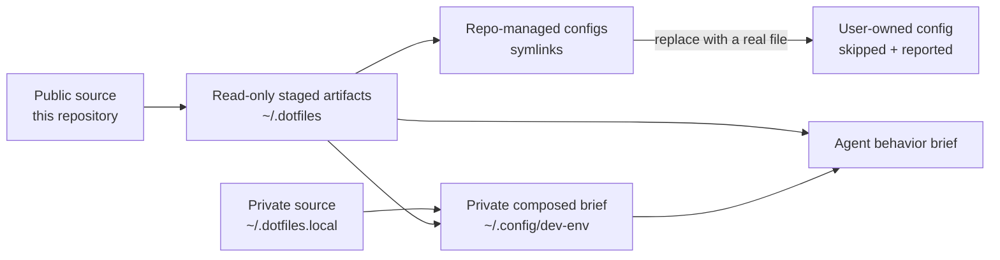

# devbook — a Mac environment that knows what it owns

devbook builds a modern shell and polyglot development stack for human and AI
coding workflows. Its central contract is simple: repository-managed configs
are symlinks; replace one with a real file and the next run leaves it alone and
records the handoff.

Most dotfiles repositories optimize for getting onto a machine. devbook also
designs for the second run, private state, agent behavior, and an eventual exit.

## Why this is different

- **Ownership is a state, not an accident.** Repository-managed configs are
  symlinks. Replace one with a real file and devbook treats it as user-owned:
  the baseline is skipped, never silently restored over it, and the divergence
  is recorded in a persistent manifest.
- **Public, private, and generated material have different fates.** This public
  repository is the baseline, `~/.dotfiles.local` is an optional private source,
  and `~/.dotfiles` is a disposable read-only artifact. Private agent context is
  composed outside the public staged tree.
- **AI tools inherit an environment contract.** One behavioral brief tells
  coding agents which runtimes, package managers, containers, and secret-handling
  conventions the machine actually uses. A separate infrastructure reviewer
  makes tradeoffs between current tooling and long-term recoverability explicit.

## Quick start

Clone (or copy) this folder anywhere, then:

```bash
chmod +x setup.sh
./setup.sh
```

Run it in a local, interactive terminal. The first run may install Homebrew,
which asks for your password once. When setup finishes, quit and reopen the
terminal (or open Ghostty) so the shell changes load.

The script is designed to converge on repeated runs. It checks before installing,
refreshes only the configs it owns, and maintains one replace-in-place block in
`~/.zshrc`. A config replaced with a real file is yours: it is skipped and
reported rather than clobbered. See **Extending** for that ownership contract.

It also **self-lints**: it installs `shellcheck` and runs it against itself at the
end (non-fatal — warnings print but never abort the run). Skip that pass with
`SKIP_SELFCHECK=1 ./setup.sh`.

## Evidence and its boundary

Run the same checks as CI without changing machine configuration:

```bash
bash scripts/check.sh
```

[](https://github.com/nfeldman/devbook/actions/workflows/contract-checks.yml)

That command checks Bash syntax and runs ShellCheck and three contract tests.
The tests cover both paths through the private sentinel gate, real-file takeover,
and marked-block convergence.

CI does not reproduce a fresh Mac installation, and does not claim to. The
installer's package-manager paths, GUI applications, and a full second machine
run still require release-time testing on macOS. The automated checks cover the
state transitions and security boundaries that can be exercised without
mutating the runner's configured machine state.

## Architecture at a glance



Neither staging nor composition copies private overlay content into this
repository or into the public staged tree. Private overlay setup code, if you
supply it, runs on your machine with your privileges. The fuller reasoning and
threat boundaries are in [the design notes](docs/design.md).

## Files in this bundle

| File | Goes to | What it is |
|------|---------|------------|
| `setup.sh` | — | The installer. Run this. |
| `starship.toml` | `~/.config/starship.toml` | Prompt config (git, language versions, k8s context). |
| `ghostty.config` | `~/.config/ghostty/config` | Terminal font, theme, keybinds. |
| `zellij.kdl` | `~/.config/zellij/config.kdl` | Terminal multiplexer config. |
| `zshrc-additions.zsh` | sourced from `~/.zshrc` | Shell init (mise, starship, zoxide, atuin, fzf, aliases). |
| `gitconfig-devbook` | included from `~/.gitconfig` | Git defaults: delta pager, zdiff3, modern QoL flags. |
| `AGENTS.md` | imported by `~/.claude/CLAUDE.md` | Machine-wide brief for AI coding agents: which tools are here and how to use them. |
| `MODELS.md` | — | Model-sovereignty posture: local-first AI, swappable vendors. |
| `HISTORY.md` | — | Sparse major-milestone history; routine detail remains in Git history. |
| `machine-steward-reviewer.md` | — | Reusable reviewer persona for infra changes (see below). |
| `CLAUDE.md` + `.claude/agents/` | — | Wires Claude Code into this repo's conventions and reviewer. |
| `githooks/pre-commit` | wired via `core.hooksPath` | Sentinel leak gate: blocks commits matching private patterns (the patterns live outside this repo — see Extending). |
| `scripts/check.sh` + `tests/` | — | Static checks and isolated executable contract tests that leave configured machine state untouched. |
| `docs/design.md` | — | Design cases, explicit claim boundaries, and validation map. |

`setup.sh` symlinks the configs into place for you (staged via `~/.dotfiles`),
and wires `gitconfig-devbook` in with a single reversible `include.path` line —
your own `~/.gitconfig` settings always win over it. The staged copies in
`~/.dotfiles` are **read-only artifacts**: edit this repo (public) or
`~/.dotfiles.local` (private), never the staged middle — a stray edit there
fails loudly instead of being silently lost on the next run.

## What gets installed and why

**Terminal & shell**
- **Ghostty** — GPU-accelerated, native macOS terminal. Fast, minimal config. Your iTerm2 replacement.
- **IosevkaTerm Nerd Font** — open, feature-rich patched font so prompt/file icons render.
- **Starship** — fast, informative prompt (git state, language versions, k8s context).
- **Zellij** — terminal multiplexer (panes, tabs, detachable sessions). Friendlier than tmux; keybinds show on screen.

**Modern CLI toolkit** (drop-in upgrades for old Unix tools)
- `eza` (ls), `bat` (cat), `fd` (find), `ripgrep`/`rg` (grep), `sd` (sed), `dust` (du), `bottom`/`btm` (top)
- `fzf` fuzzy finder (ctrl-t), `zoxide` smart cd (`z`), `atuin` searchable history (owns ctrl-r)
- `git-delta` pretty diffs, `lazygit` git TUI, `gh` GitHub CLI; **Sourcetree** (Git GUI)
- `jq`/`yq` for JSON/YAML, `direnv` per-project env, `tldr` concise man pages
- `age` modern file encryption, `op` (1Password CLI) for secrets in scripts
- **Firefox** — the independent, non-Chromium browser engine: cross-engine dev testing, and an anti-monoculture daily driver (the `MODELS.md` posture, applied to browsers)

**Language runtimes**
- **mise** — polyglot version manager (replaces nvm/pyenv/rbenv/g). Rust-fast, one tool for Node, Python, Go, and Bun. Installs Node LTS, Python 3.12, Go, and Bun globally; override per-project with a `mise.toml`. (Rust uses **rustup**; Lean uses **elan**.)
- **uv** — Astral's ultrafast Python package/project manager. Use it for venvs and dependencies (`uv init`, `uv add`, `uv run`). Great for ML/AI work.
- **elan** — official Lean toolchain manager (rustup's equivalent for Lean). Installs latest stable Lean 4 globally and auto-switches to whatever a project's `lean-toolchain` file pins.

**Containers / DevOps**
- **OrbStack** — fast, light Docker Desktop replacement (Docker + a local Kubernetes). Big battery/RAM win.
- `kubectl`, `k9s` (cluster TUI), `helm`.

**AI-forward**
- **Ollama** — run LLMs locally, vendor-free (`ollama pull qwen3-coder:30b`, `ollama run ...`). Your sovereign default; see `MODELS.md` for picks by RAM tier.
- **Claude Code** — Anthropic's agentic CLI, installed via the official native installer (signed, auto-updating, no Node dependency). Run `claude` in any repo. The one intentional vendor tool, balanced by keeping everything else local-capable.
- **Agent context** (`AGENTS.md`) — a machine-wide brief that tells any coding agent which tools are installed here and how you expect them used (mise, uv, `rg`/`fd`, OrbStack, `op`, …). Wired into Claude Code globally; fan it out per-repo with `agents-here`. See below.
- No cloud-agent CLI is installed by default — add a neutral one later (e.g. **opencode**: open source, bring-your-own-model), pointed at Ollama first. See `MODELS.md`.

## Recommended post-install steps

1. **Ghostty font**: if it didn't auto-apply, set font to `IosevkaTerm Nerd Font` (already in `ghostty.config`).
2. **git**: nothing to do — `setup.sh` wires `gitconfig-devbook` (delta pager,
   zdiff3 conflicts, `push.autoSetupRemote`, rerere, histogram diffs)
   into your global config via one `include.path` line. To undo it all:
   `git config --global --unset include.path ~/.dotfiles/gitconfig-devbook`.
3. **mise**: run `mise doctor` to confirm it's wired up. Per project, `mise use node@22` etc. writes a `mise.toml`.
4. **atuin** (optional): `atuin register` to sync/encrypt history across machines, or just use it locally.
5. **Ollama**: `ollama pull qwen3-coder:30b` (32 GB RAM; see `MODELS.md` for the 16 GB and 64 GB+ picks).
6. **Claude Code**: run `claude` in a project and follow the login prompt.

## Per-project workflow (the modern flow)

- **Node/TS**: `mise use node@lts` → `npm create vite@latest` or `pnpm`, etc.
- **Bun**: available globally via mise; pin a project with `mise use bun@<version>`.
- **Python/ML**: `uv init myproj && cd myproj && uv add pandas torch` → `uv run python ...`. No manual venv activation.
- **Go**: `mise use go@latest` → `go mod init`.
- **Rust**: rustup already set stable as default → `cargo new`.
- **Lean**: `lake new myproj` → `lake build`. elan picks the toolchain from the project's `lean-toolchain` file automatically.
- **Env vars/secrets**: drop a `.envrc` in the project (`direnv allow`) — auto-loads on `cd`.

## One brief for every agent (AGENTS.md)

AI coding tools each read their own instruction file, so the same environment
facts get repeated — or, worse, an agent guesses wrong (reaches for `pip`,
assumes Docker Desktop, greps instead of `rg`). `AGENTS.md` is the single
source of truth: **behavioral rules, not an inventory** — how this machine
expects tools to be used.

- **Machine-wide (automatic):** `setup.sh` stages `AGENTS.md` to
  `~/.dotfiles/AGENTS.md` and adds one reversible marked block to
  `~/.claude/CLAUDE.md` that `@`-imports it, so **Claude Code loads it in every
  session, in every repo**. Your own global memory in that file is left intact;
  delete the `<!-- >>> dev-env agents >>> -->` block to undo it. If a private
  overlay brief exists (`~/.dotfiles.local/AGENTS.local.md`), setup composes
  public + private into `~/.config/dev-env/AGENTS.composed.md` and imports that
  instead. The composition path writes private content only to that local,
  mode-`600` file; agents without a private overlay receive the public brief.
- **Per-repo (one command):** run `agents-here` in a project to write a starter
  `AGENTS.md` and point the project-scoped tools at it — Claude Code
  (`CLAUDE.md`) and GitHub Copilot (`.github/copilot-instructions.md`) via
  symlink. **Cursor and Codex read `AGENTS.md` natively**, so they need
  nothing. Real (non-symlink) files are skipped, never clobbered.

Why only Claude Code gets the *machine-global* wiring: it's the one agent
devbook installs that has a true user-level memory file. Copilot and
Cursor are project-scoped here, and `agents-here` provides a way to reach
them, one repo at a time, from the same source file.

## Extending — the private overlay (`~/.dotfiles.local`)

devbook is a **public baseline**. Anything personal — private aliases, a work
git identity, machine-specific agent context — belongs in `~/.dotfiles.local`,
a **private repo** the baseline knows how to consume. devbook's staging loop
copies only named files from this checkout; private composition is written to
`~/.config/dev-env`, not back into this repository or the public staged tree.
An executable overlay setup is trusted local code and remains outside that
separation guarantee.

To start one:

```bash
mkdir -p ~/.dotfiles.local && git init ~/.dotfiles.local
```

then add any of the files below — **all optional** — and re-run `./setup.sh`;
the hooks notice whatever exists. On a fresh machine the order doesn't matter:
clone devbook and run it, restore or clone your overlay to `~/.dotfiles.local`,
run `./setup.sh` once more — both orders converge on the same state.

- `zshrc.zsh` — sourced *last* by the shell init, so it overrides anything here.
- `gitconfig` — wired in as a second `include.path`; unwired automatically if
  the overlay disappears.
- `ghostty.config` — pulled in by an optional include (missing file = no-op).
- `AGENTS.local.md` — composed with the public brief (see the agents section).
- `sentinels.txt` — private strings the pre-commit gate blocks from ever being
  committed here, one fixed string per line, matched case-insensitively (the
  hook ships in this repo; the patterns stay private).
- `setup.sh` — your own installer, run (contained) at the end of this one.
  Skip it with `SKIP_LOCAL=1 ./setup.sh`.

Three layers, three fates: **this repo** is the public source (GitHub protects
it), **`~/.dotfiles.local`** is the private source (your backups protect it),
and **`~/.dotfiles` + `~/.config/dev-env`** are disposable artifacts —
re-running regenerates them, so protect nothing there. Whole-file configs with
no include mechanism (starship, zellij) use the takeover contract instead:
replace the symlink with a real file to own it — setup then skips it and
reports the divergence (also into `~/.config/dev-env/manifest.txt`); delete
your file and re-run to return to baseline. Removing the overlay entirely and
re-running restores the exactly-public state: composite deleted, include
unwired, hooks silent (to unwire the leak-gate hook itself:
`git config --unset core.hooksPath` in this checkout).

## Keeping it current

- `dev-up` (alias installed by the zshrc block) refreshes everything in one go:
  brew packages, mise runtimes, and the Rust toolchain.
- Re-running `./setup.sh` anytime picks up new additions to this repo — it's idempotent.

## Reviewing changes with AI (dogfooding)

This repo carries its own reviewer. `machine-steward-reviewer.md` is a
steward + conservator persona for auditing infra changes, and
`.claude/agents/machine-steward.md` registers it as a Claude Code subagent.
Inside `claude`, changes to `setup.sh` or the dotfiles can be routed to a reviewer
that checks correctness, idempotency, reversibility, and key custody. `CLAUDE.md`
makes that the documented default workflow; it is a review convention, not a
commit gate. The README and design-story rewrite includes a compact
[adversarial/editorial review receipt](docs/reviews/2026-08-25-positioning.md).

## Notes & swaps

- **Future baseline candidate:** `ruff`. Python repositories commonly make it a CI gate, and
  a missing global binary forces an otherwise unnecessary `uvx` download during local
  validation. It is small, broadly useful, and available as a Homebrew formula; consider
  adding it to a future `setup.sh` update after the usual idempotency and README-sync review.
- **Future agent-workflow candidate:** `pecia`. Local dogfood found its deterministic,
  append-only work ledger useful for long-running roadmap custody. Do not baseline it yet:
  Pecia v2's `init` and `doctor` currently disagree about the merge attribute, and adopter
  repositories still need a portable hook and distribution contract. Reconsider after those
  are resolved and the usual idempotency, clean-export, and README-sync checks pass.
- Prefer **WezTerm** over Ghostty? Replace the Ghostty line with `brew_cask wezterm` and skip `ghostty.config`.
- Already have a browser you love? Delete the `brew_cask firefox` line.
- Want tmux instead of Zellij? Swap `brew_formula zellij` for `brew_formula tmux` (configs differ).
- Everything here is Homebrew-managed: `brew upgrade` keeps it all current.
