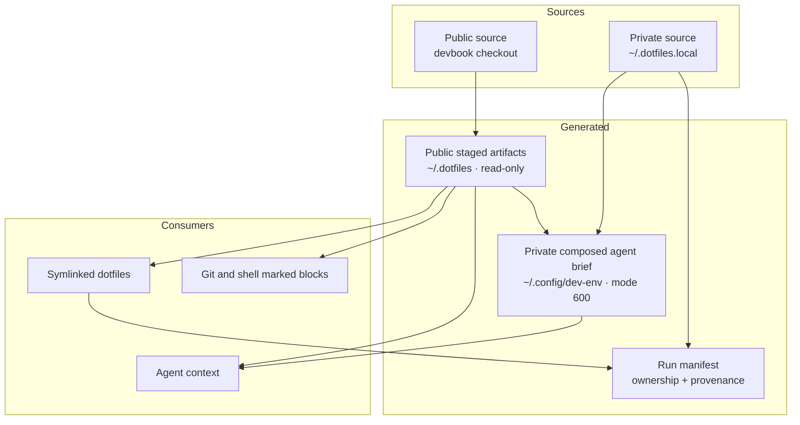
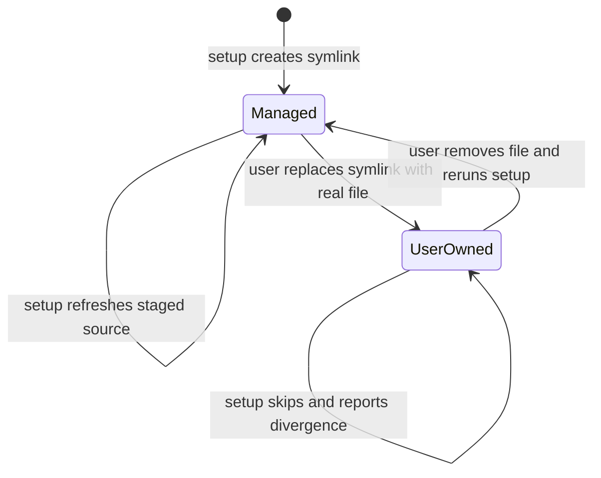

# Design notes — ownership, privacy, and recovery

devbook is a macOS bootstrap, but its design problem is broader than package
installation: how can one repository reconcile a working machine repeatedly
without confusing public source, private source, generated state, and files the
user has chosen to own?

These notes make the repository's consequential claims inspectable. They also
state what the current evidence does **not** establish.

## The system and its trust boundaries

The executable `~/.dotfiles.local/setup.sh` hook is outside this diagram. It is
trusted local code and can change the host; the diagram describes only devbook's
staging and composition paths.

## Claims, evidence, and limits

| Claim | Evidence in this repository | What the evidence does not justify |
|---|---|---|
| A user can take ownership of a whole-file config without it being overwritten on the next run. | `link()` skips a real destination and appends it to `DIVERGED_LIST`; the later manifest writer persists that list. The contract suite executes the skip and list mutation, but not the manifest write. | That every third-party installer invoked by setup is itself non-destructive. |
| Managed marked blocks converge instead of multiplying. | `ensure_marked_block()` removes the prior marked region, preserves surrounding content, and writes one current block; the contract suite runs the transition twice. | Full-machine idempotence across every future Homebrew, mise, rustup, or GUI application state. |
| Private agent context is kept out of the public staging path. | Staging copies only named files from this checkout; private composition writes to `~/.config/dev-env/AGENTS.composed.md` and then sets mode `600`. | Containment from a malicious or mistaken private overlay script, which is trusted host code. This transition is inspected in code but not yet exercised by the contract suite. |
| A configured private sentinel can stop a matching staged change. | The hook reads a machine-private fixed-string list; the contract suite observes both an allowed staged change and a rejected one. | General secret detection. With no sentinel list, the hook intentionally does nothing; a secret not named by the list is outside its coverage. |
| The repository defines a specialized AI review lane for infrastructure changes. | The reviewer contract and repository instruction make the steward/conservator lane explicit. | That the lane always runs, or that a reviewer is correct merely because it ran. Findings still require validation against the artifacts and environment. |

## Design case 1: three stores, three fates

Many dotfile systems collapse source, customization, and installed state into one
Git repository. That is convenient until a machine-specific value is committed,
a generated edit is mistaken for source, or a public baseline becomes unusable
without private history.

devbook assigns the stores different custody:

1. **This repository is public source.** It contains the portable baseline and
   the code that knows how to consume optional private inputs.
2. **`~/.dotfiles.local` is private source.** It can contain identity, aliases,
   private agent context, leak sentinels, and an optional trusted setup hook.
3. **`~/.dotfiles` and `~/.config/dev-env` are generated artifacts.** They are
   reproducible from their sources and are not backup authorities.

The distinction is operational, not just documentary: public artifacts are
staged only from named files in this checkout, while a private composed brief is
written elsewhere with restrictive permissions. Removing the private brief and
re-running removes the stale composition.

## Design case 2: ownership as a state transition

A symlink at a managed destination means “follow the baseline.” A real file means
“the user took over.” Setup does not need a separate ownership database because
the filesystem state is the declaration.

The persistent manifest makes the skipped state visible after terminal output has
scrolled away. This contract applies to whole-file configurations. Files that
support inclusion use a narrower reversible mechanism: one Git include or one
marked block surrounded by user-owned content.

## Design case 3: an agent reviewer with two duties in tension

The machine reviewer combines an infrastructure steward, who prizes current
tools and low friction, with a preservation conservator, who prizes reversibility,
legibility, and durable recovery. The useful part is not the persona by itself;
it is the forced disclosure of a real tradeoff when those duties disagree.

The repository therefore treats the reviewer as a challenge generator, not an
authority. A finding has to name evidence, severity, and a concrete fix, and the
implementation is validated independently before the finding is accepted.
The public-story rewrite has a compact
[review receipt](reviews/2026-08-25-positioning.md) showing that process and one
finding rejected after verification.

## Validation map

`bash scripts/check.sh` leaves configured machine state untouched. Its contract
tests write only to a disposable temporary workspace. It currently runs:

- Bash syntax checks and ShellCheck over every repository shell entry point;
- an accepted change and a rejected change for the private sentinel gate; and
- real-file takeover and marked-block convergence checks against functions
  extracted from the installer.

The suite does not install packages or mutate the runner's global configuration.
A complete release check still needs a real macOS machine: run setup from a clean
baseline, run it again, inspect the manifest, and exercise any GUI handoffs.
